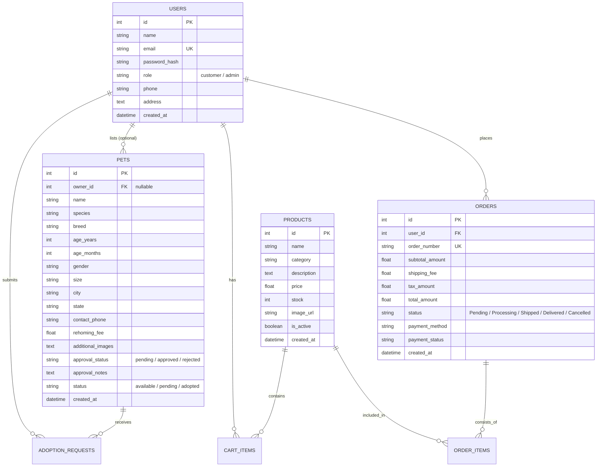

# Adopt n Shop – Online Pet Adoption and E-Commerce Management System

[](https://www.python.org/)
[](https://flask.palletsprojects.com/)
[](https://getbootstrap.com/)
[](https://www.sqlite.org/)
[](#license)

> **Final-Year BCA Capstone Project**  
> An integrated, full-stack web application bridging pet rescue shelters, compassionate pet parents, and pet supply retail with full Indian localization and community rehoming.

---

## Table of Contents

- [Project Overview](#project-overview)
- [Key Features](#key-features)
  - [1. User Authentication & Access Control](#1-user-authentication--access-control)
  - [2. Pet Adoption Module](#2-pet-adoption-module)
  - [3. Customer Pet Listing & Rehoming](#3-customer-pet-listing--rehoming)
  - [4. Pet Supply E-Commerce Shop](#4-pet-supply-e-commerce-shop)
  - [5. Shopping Cart & Simulated Checkout](#5-shopping-cart--simulated-checkout)
  - [6. Order Tracking & Itemized Invoicing](#6-order-tracking--itemized-invoicing)
  - [7. Comprehensive Administrator Portal](#7-comprehensive-administrator-portal)
- [Technology Stack](#technology-stack)
- [Database Schema](#database-schema)
- [Installation & Local Setup](#installation--local-setup)
- [Pre-Seeded Demo Credentials](#pre-seeded-demo-credentials)
- [Running Automated Tests](#running-automated-tests)
- [Directory Structure](#directory-structure)
- [Contributing & License](#contributing--license)

---

## Project Overview

**Adopt n Shop** solves two major challenges in the companion animal ecosystem:
1. Connecting prospective pet parents with rescue animals awaiting loving homes across Indian cities.
2. Providing a seamless e-commerce storefront for pet nutrition, toys, accessories, and healthcare supplies.

In addition to certified shelter rescues, registered customers can list their own pets for community adoption with full administrative oversight, transparent rehoming fees in Indian Rupees (₹), and strict ownership security.

---

## Key Features

### 1. User Authentication & Access Control
- Secure user registration and login powered by **Flask-Login**.
- Strong password hashing with **Werkzeug** (`scrypt` / `pbkdf2:sha256`).
- Role-Based Access Control (**RBAC**): Separate customer and administrator roles with automated route guards (`@admin_required`, `@login_required`).
- Personalized user profile management with order history and adoption inquiry records.

### 2. Pet Adoption Module
- Search pets by name, breed, species, gender, or Indian location.
- Rich Pet Profile cards with medical/vaccination badges, temperament details, and high-resolution photo galleries.
- Structured adoption application form capturing living accommodations, previous pet experience, and motivation.
- User application status tracking: `Pending Review` 🟡, `Approved` 🟢, or `Rejected` 🔴.

### 3. Customer Pet Listing & Rehoming
- **Community Listing Submission**: Registered pet owners can list pets for rehoming with multiple photo uploads, city, state, contact phone, and optional transparent rehoming fee in INR (₹).
- **Safety Verification Workflow**: Every customer submission begins in `Pending Approval` status and is completely hidden from public pages until verified by an administrator.
- **Customer "My Listings" Portal**: Allows pet owners to monitor verification status, view incoming adoption requests, mark pets as adopted, or edit/delete listings.
- **Strict Ownership Checks**: Backend guards ensure customers cannot view unapproved pets or edit/delete listings belonging to another user (`403 Forbidden`).

### 4. Pet Supply E-Commerce Shop
- Categorized product catalogue: **Food**, **Toys**, **Accessories**, and **Healthcare**.
- Dynamic search, category pills, and sorting (price low-to-high, high-to-low, newest).
- Detailed product pages with live inventory stock indicators, specifications, and related items.

### 5. Shopping Cart & Simulated Checkout
- Database-persisted shopping cart across sessions for logged-in customers.
- Live quantity adjustment bounded by warehouse inventory.
- Automatic free shipping calculation (Free above ₹999, else ₹99) and estimated GST (5%).
- Simulated checkout with multiple Indian payment methods:
  - **UPI / QR** (Google Pay, PhonePe, Paytm simulation)
  - **Credit / Debit Cards** (Visa, MasterCard, RuPay simulation)
  - **Cash on Delivery (COD)**
- Instant inventory decrement and celebratory order confirmation.

### 6. Order Tracking & Itemized Invoicing
- Customer order history with fulfillment progress timeline:
  `Order Placed` &rarr; `Processing` &rarr; `Shipped` &rarr; `Delivered`.
- Printable itemized invoice view with order reference number, delivery address, and breakdown.

### 7. Comprehensive Administrator Portal
- **Dashboard & KPIs**: Total revenue in INR, available pets, pending adoptions, and active orders.
- **Visual Analytics**: Interactive **Chart.js** charts for pets by species, products by category, and order fulfillment breakdown.
- **Pet Listing Approvals**: Review customer-submitted listings, inspect caregiver contact info and photos, and Approve or Reject with custom feedback.
- **Shelter Pet Management**: Add, update, and manage shelter rescue records.
- **Adoption Applications Review**: Approve or reject applicant submissions with feedback notes.
- **Product Inventory Management**: Add, edit, activate/deactivate supplies, and replenish stock.
- **Order Processing**: Update live fulfillment statuses from Pending to Delivered.
- **Customer Directory**: View registered users, contact info, and activity summaries.

---

## Technology Stack

| Layer | Technologies |
| :--- | :--- |
| **Backend Framework** | Python 3.10+, Flask 3.1.3 |
| **ORM & Database** | Flask-SQLAlchemy 3.1.1, SQLite 3 |
| **Authentication** | Flask-Login 0.6.3, Werkzeug Security |
| **Templating Engine** | Jinja2 3.1.6 (with custom Indian currency `|inr` formatting filter) |
| **Frontend Framework** | Bootstrap 5.3.3, Bootstrap Icons 1.11.3 |
| **Data Visualizations**| Chart.js (via RESTful JSON analytics endpoints) |
| **Testing** | Python `unittest` framework |

---

## Database Schema



---

## Installation & Local Setup

### 1. Prerequisites
- Python 3.10, 3.11, 3.12, 3.13, or 3.14 installed on your computer.
- Git installed on your system.

### 2. Clone the Repository
```bash
git clone https://github.com/your-username/adopt-n-shop.git
cd adopt-n-shop
```

### 3. Create and Activate a Virtual Environment
- **On Windows (PowerShell):**
  ```powershell
  python -m venv venv
  .\venv\Scripts\Activate.ps1
  ```
- **On macOS / Linux:**
  ```bash
  python3 -m venv venv
  source venv/bin/activate
  ```

### 4. Install Dependencies
```bash
pip install -r requirements.txt
```

### 5. Configure Environment Variables
Copy the sample environment file:
```bash
cp .env.example .env
```
*(On Windows Command Prompt / PowerShell, use `copy .env.example .env`)*

### 6. Initialize & Seed Database
Populate the database with realistic Indian profiles, pets, products, and sample orders:
```bash
python seed_data.py
```

### 7. Run the Application
```bash
python app.py
```
Open your web browser and visit: **`http://127.0.0.1:5000/`**

---

## Pre-Seeded Demo Credentials

| Role | Name | Email Address | Password |
| :--- | :--- | :--- | :--- |
| **Administrator** | Aarav Sharma | `admin@adoptnshop.com` | `admin123` |
| **Customer** | Rohan Verma | `rohan@example.com` | `user123` |
| **Customer** | Priya Patel | `priya@example.com` | `user123` |
| **Customer** | Ananya Iyer | `ananya@example.com` | `user123` |

---

## Running Automated Tests

A comprehensive unit and integration test suite is included:
```bash
python test_app.py
```

**Test Coverage Includes:**
- Public routes and page availability (HTTP 200).
- Pet search and species filtering.
- E-commerce search, categories, and price sorting.
- Authentication security, incorrect password rejection, and RBAC admin protection.
- Admin dashboard KPI calculations and Chart.js analytics API.
- Adoption application workflow (Submission &rarr; Admin Review &rarr; Status update).
- Shopping cart lifecycle, inventory stock decrement, and order generation.
- Customer pet listing full lifecycle:
  - Form submission with photo upload and INR rehoming fee.
  - Verification of `Pending Approval` state and hidden status from public catalogue.
  - Ownership security checks (Customer B receives `403` when attempting to edit/delete Customer A's listing).
  - Customer listing modification and re-review submission.
  - Admin inspection, approval, and live publication.

---

## Directory Structure

```
adopt-n-shop/
├── .env.example              # Sample environment configuration template
├── .gitignore                # Git exclusions (DB, uploads, venv, secrets)
├── app.py                    # Main Flask application, routes, and filters
├── config.py                 # Configuration settings and env variables
├── migrate_db.py             # Non-destructive SQLite schema migration script
├── models.py                 # SQLAlchemy database models and relationships
├── README.md                 # Project documentation & setup guide
├── requirements.txt          # Python dependencies
├── seed_data.py              # Realistic Indian sample data generator
├── test_app.py               # Complete test suite
│
├── static/                   # Static web assets
│   ├── css/
│   │   ├── admin.css         # Admin portal styling & charts
│   │   └── style.css         # Main application design system
│   ├── images/               # Default SVGs and fallback placeholders
│   ├── js/
│   │   ├── admin.js          # Chart.js analytics & sidebar logic
│   │   └── main.js           # Client interactions & image previews
│   └── uploads/              # User-uploaded files (gitignored with .gitkeep)
│       ├── pets/
│       └── products/
│
└── templates/                # Jinja2 HTML5 templates
    ├── base.html             # Base layout with responsive navigation & footer
    ├── index.html            # Homepage with hero CTA & featured sections
    ├── about.html            # About platform & shelter mission
    ├── contact.html          # Contact form & shelter info
    ├── admin/                # Admin management templates
    │   ├── layout.html       # Admin sidebar & header
    │   ├── dashboard.html    # KPI cards & Chart.js visualizations
    │   ├── listing_approvals.html # Customer pet review & approval portal
    │   ├── pets.html         # Shelter pet management
    │   ├── pet_form.html     # Add/edit shelter pet
    │   ├── adoptions.html    # Adoption request review & decision
    │   ├── products.html     # Product inventory table
    │   ├── product_form.html # Add/edit product
    │   ├── orders.html       # Order fulfillment dashboard
    │   ├── order_detail.html # Admin order itemization
    │   └── customers.html    # Registered customer directory
    ├── auth/                 # User authentication
    │   ├── login.html
    │   ├── register.html
    │   └── profile.html
    ├── cart/                 # Shopping cart & checkout
    │   ├── view.html
    │   └── checkout.html
    ├── orders/               # Order history & receipts
    │   ├── confirmation.html
    │   ├── my_orders.html
    │   └── detail.html
    ├── pets/                 # Adoption & customer listings
    │   ├── list.html         # Public pet catalogue
    │   ├── detail.html       # Pet profile & traits
    │   ├── apply.html        # Adoption request form
    │   ├── my_requests.html  # Track application status
    │   ├── list_pet.html     # Customer pet submission form
    │   ├── edit_pet.html     # Customer pet edit form
    │   ├── my_listed_pets.html # Customer listings dashboard
    │   └── pet_applications.html # Inquiries on listed pet
    ├── shop/                 # E-commerce store
    │   ├── list.html
    │   └── detail.html
    └── errors/               # Custom error handlers (403, 404, 500)
```

---

## License

This project is developed for educational and academic evaluation purposes as a BCA Final-Year Capstone Project. Distributed under the MIT License.
